  

<table>
<tr>
<!-- ═══════════ COLUMNA IZQUIERDA (showcases) ═══════════ -->
<td width="66%" valign="top">

<!-- Cambia showcase.svg por tu render, por ejemplo: assets/mi-render.png -->

₊˚⊹ ✧ ⋆ ♡ ⋆ ✧ ⊹˚₊

  
  

  

</td>

<!-- ═══════════ COLUMNA DERECHA (panel tipo Steam) ═══════════ -->
<td width="34%" valign="top">

  

  
  
  

**♡ Dirección y Gestión de Videojuegos** 
estudiante

**♡ [Portafolio 3D](https://TU-LINK-DEL-PORTAFOLIO)** 
mis trabajos

</td>
</tr>
</table>

  

